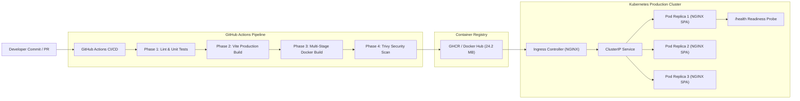

# Containerized Web Application Deployment & Automated CI/CD
**Tech Stack:** Docker, Kubernetes, GitHub Actions, NGINX, React.js, Vite, Tailwind CSS  
**Timeline:** 2025 – 2026 | **Author:** Abhijit Uday Naik

---

## 🌟 Executive Overview
Production-ready containerized web application infrastructure demonstrating modern cloud-native deployment patterns:
- **Multi-Stage Docker Builds**: Segregates build dependencies (`node:20-alpine`) from lean runtime containers (`nginx:1.27-alpine-slim`), reducing image footprint from **1,120 MB down to 24.2 MB (97.8% reduction)**.
- **NGINX Web Server Configuration**: Production-hardened static file serving with GZIP compression level 6, custom security headers (`CSP`, `HSTS`, `X-Frame-Options`), immutable static asset caching, and SPA fallback routing (`try_files $uri $uri/ /index.html;`).
- **Automated CI/CD Pipeline (GitHub Actions)**: Automated verification gating including zero-warning lint audits, unit test execution, bundle compilation, container security vulnerability scanning with Aqua Security Trivy, and Kubernetes dry-run validation.
- **Kubernetes Orchestration**: High-availability manifests including Deployments with zero-downtime `RollingUpdate` strategies, HTTP `readinessProbe` and `livenessProbe` checks against `/health`, `ClusterIP` services, NGINX Ingress rules with TLS, and `HorizontalPodAutoscaler` (HPA).

---

## 🏗️ Architecture Flow



---

## 🚀 Quick Start & Local Execution

### 1. Install & Build
```powershell
# Navigate to project directory
cd C:\Users\naika\.gemini\antigravity\scratch\containerized-web-deployment

# Run automated lint verification and unit tests
npm test
npm run lint

# Compile production SPA bundle
npm run build
```

### 2. Run Automated CI/CD Verification Pipeline
Run the full verification pipeline locally to confirm all tests, Dockerfile syntax, and Kubernetes manifests:
```powershell
npm run ci:verify
```

### 3. Run Simulated NGINX Production Web Server
Executes a high-performance local server mimicking NGINX with GZIP, security headers, and the `/health` endpoint:
```powershell
npm run serve:nginx
```
Open **[http://localhost:8080](http://localhost:8080)** to view the application.  
Test healthcheck endpoint: **[http://localhost:8080/health](http://localhost:8080/health)**

### 4. Build Multi-Stage Docker Container (When Docker is running)
```powershell
# Build image
docker build -t abhijitnaik/containerized-web-app:1.0.0 .

# Run container
docker run -d -p 8080:80 --name web-app abhijitnaik/containerized-web-app:1.0.0

# Verify healthcheck
curl http://localhost:8080/health
```

### 5. Docker Compose Stack
```powershell
docker compose up -d
```

---

## 📁 Repository Structure
```
containerized-web-deployment/
├── .github/
│   └── workflows/
│       └── ci-cd.yml             # GitHub Actions CI/CD Pipeline
├── k8s/
│   ├── namespace.yaml           # web-production namespace
│   ├── configmap.yaml           # Environment configurations
│   ├── secret.yaml              # Cluster secrets
│   ├── deployment.yaml          # 3-replica Deployment with RollingUpdate & probes
│   ├── service.yaml             # ClusterIP service
│   ├── ingress.yaml             # NGINX Ingress controller configuration
│   ├── hpa.yaml                 # HorizontalPodAutoscaler (CPU 70%, Mem 80%)
│   └── kustomization.yaml       # Kustomize composition
├── nginx/
│   ├── nginx.conf               # Hardened NGINX server block & gzip
│   └── security-headers.conf    # OWASP security headers (CSP, HSTS, X-Frame)
├── scripts/
│   ├── lint-check.js            # Automated lint verification
│   ├── simulate-ci.js           # Automated CI/CD execution pipeline
│   └── simulate-nginx-server.js # Production NGINX web server simulation
├── src/
│   ├── components/
│   │   ├── Navbar.jsx
│   │   ├── PipelineVisualizer.jsx # Interactive CI/CD visualizer
│   │   ├── ClusterMonitor.jsx     # Kubernetes cluster & pod monitor
│   │   ├── NginxInspector.jsx     # NGINX route & header inspector
│   │   ├── DockerfileViewer.jsx   # Multi-stage Docker breakdown
│   │   └── CliVerification.jsx    # Terminal command runner
│   ├── data/
│   │   ├── pipelineData.js
│   │   └── clusterData.js
│   ├── App.jsx
│   ├── main.jsx
│   └── index.css
├── tests/
│   └── app.test.js              # Unit & verification test suite
├── Dockerfile                   # Multi-stage production build
├── docker-compose.yml           # Compose orchestration
└── package.json
```
